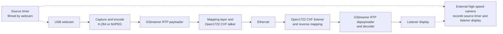

# Project RTS Video Streaming

## Goals

1. Capture video from a webcam and stream it over Ethernet using Open1722 CVF, supporting both H.264 and MJPEG.
2. Measure glass-to-glass latency and investigate which factors affect it.

Open1722 already supports CVF headers, but its example applications need extensions and integration to support this webcam streaming use case. Any required library changes will be identified during the code audit.

## Project Plan

1. Obtain suitable hardware and confirm supported webcam formats.
2. Inspect the relevant Open1722 examples, build and test the existing code, and identify required changes.
3. Test local capture and both codecs with GStreamer, then establish an RTP/UDP connection between the two computers as a baseline.
4. Implement the CVF streaming integration:
   - H.264 CVF implementation using GStreamer's RTP packetizer and depacketizer.
   - MJPEG CVF implementation using the shared integration.
   - Correct payload mapping, fragmentation, markers, timestamps, pacing, and presentation scheduling.
5. Validate the streams using Wireshark and independent depayloaders. Add relevant tests and listener statistics, and verify a warning-free strict build.
6. Establish an external optical latency measurement setup. Film a source timer and the receiving display together, compare their displayed times, and document measurement uncertainty. Add synchronized software timing to investigate individual pipeline stages.
7. Compare H.264 and MJPEG at comparable visual quality and matching resolutions/frame rates. Compare CVF with the RTP/UDP baseline and investigate selected encoder, buffering, and timing settings. Start at 720p30, then test 1080p where hardware permits.
8. Analyse latency, jitter, loss, bandwidth, and CPU usage. Complete scripts, raw data, setup instructions, and the final report.

### Order and Dependencies

- Hardware availability is required before live camera and network testing.
- The Open1722 audit and GStreamer baseline can proceed in parallel.
- CVF implementation depends on the integration design and working GStreamer pipelines.
- MJPEG can reuse the transport and integration developed for H.264.
- Controlled experiments depend on validated streams and a repeatable measurement method.
- Validation and documentation continue throughout the project.

## System Overview



## Build and Run the Talker and Listener

The Meson build provides two independent programs: `open1722-talker` captures
`/dev/video0`, encodes H.264, and sends RTP over UDP; `open1722-listener`
listens for that stream and displays the decoded video. Both use UDP port `5000`
by default. The talker accepts an optional listener IP (default
`127.0.0.1`) and UDP port (default `5000`); the listener accepts an optional
listening port (default `5000`).

On Debian, Ubuntu, and Raspberry Pi OS, install the compiler, `clang-format`,
Meson, Ninja, GStreamer development files, and runtime plugins with the setup
script:

```sh
./scripts/install-dependencies.sh
```

It uses `sudo` to install system packages. This is a one-time step per machine;
it does not run automatically during `git clone`. You can also run the
**Install dependencies (Debian/Ubuntu)** task in VS Code. Other Linux
distributions need the equivalent packages from their package manager. The
talker requires GStreamer's `h264parse` element from the bad plugins package;
if it is missing, install `gstreamer1.0-plugins-bad` and verify it with
`gst-inspect-1.0 h264parse`.
Configure and build both programs:

```sh
meson setup build
meson compile -C build
meson test -C build
```

### Git hooks

This repository uses local Git hooks to keep formatting and build checks in sync
with the project workflow. The hook definitions live in `.githooks/` and are
enabled with:

 ```sh
 ./scripts/setup-git-hooks.sh
```

After that, every `git push` configures the Meson build, compiles both programs,
and runs the tests. A failed build or test prevents the push. The setup script
preserves any existing Git hook configuration rather than replacing it.

For two different machines, find their IPv4 addresses with this command on
each machine:

```sh
ip -br -4 addr
```

Use the listener machine's address on the Ethernet or network interface that
can be reached from the talker. The machines need IP addresses on a mutually
reachable network; a direct Ethernet cable without DHCP may require assigning
static addresses. Do not use `127.0.0.1` for a remote listener, because it
refers to the local machine. You can check basic reachability from the talker
with `ping <listener-ip>` (although a firewall may block ping).

Start the listener on the listening computer, optionally specifying a port:

```sh
./build/open1722-listener
```

Then start the talker on the computer with the webcam, using the listener's IP
address:

```sh
./build/open1722-talker 192.168.1.20
```

Pass the listener IP and matching UDP port to the talker to stream between
computers; both programs default to port `5000`. For example, use
the same custom port on both programs:

```sh
./build/open1722-listener 5001
./build/open1722-talker 192.168.1.20 5001
```

The talker defaults to `127.0.0.1`, so both programs can run on one computer by
leaving the defaults unchanged.

### Using a Windows USB camera from WSL

USB cameras connected to Windows are not automatically available inside WSL.
To run the talker in WSL, pass the camera through with
[usbipd-win](https://learn.microsoft.com/windows/wsl/connect-usb):

1. In PowerShell running as Administrator, list USB devices and bind the
   camera's bus ID:

   ```powershell
   usbipd list
   usbipd bind --busid <BUSID>
   ```

2. In regular PowerShell, attach the camera to WSL:

   ```powershell
   usbipd attach --wsl --busid <BUSID>
   ```

3. In WSL, verify that a video device is available, then start the talker:

   ```sh
   ls /dev/video*
   ```

The camera is unavailable to Windows while attached to WSL. This step is only
needed when the camera is connected to Windows and the talker runs in WSL;
native Linux setups do not need USB passthrough.

In VS Code, choose **Terminal: Run Task** to install dependencies, then run
**Configure Meson** once (or again after changing build settings). Then choose
**Format talker** to run `clang-format` on the talker source. Choose **Start
talker** or **Start listener** as needed. Each start task compiles only its
target, prompts for its arguments, and launches it. Stop a running stream with
Ctrl+C.

You do not need to delete build artifacts before recompiling; Meson rebuilds
targets when their sources change. Run **Configure Meson** again if build
settings change. Only remove `build/` if you want to force a clean rebuild or
recover from a corrupted build directory, then run **Configure Meson** again.

## Hardware List

1. Two Raspberry Pi 4 or 5 boards, with suitable power supplies and cooling. This is the proposed embedded setup; the project brief uses two Linux PCs as the reference. Validate performance at 720p30 before increasing resolution or frame rate.
2. Two microSD cards, preferably 32 GB or larger, one per Raspberry Pi.
3. A UVC USB webcam supporting raw video and MJPEG. Confirm the exact model's supported modes before selection. Native H.264 output is optional because encoding can be performed in software.
4. One Ethernet cable for a direct connection.
5. A listener monitor and suitable micro-HDMI-to-HDMI cable, plus a source timer display. A separate device can provide the timer display.
6. A smartphone or camera capable of high-speed recording, preferably 120 or 240 fps, and a stable mount for optical latency measurements.
7. Keyboard and mouse as needed for setup.

## Planned Repository Structure

The following structure is proposed and may change during implementation.

```text
.
├── docs/                      # Project plan, hardware list, diagrams, and report
├── scripts/                   # Setup, experiment, and analysis scripts
│   └── analyze_latency.py     # Analyse recorded latency data and generate plots
├── src/
│   ├── talker/                # Talker: Webcam → GStreamer → Open1722 → Ethernet
│   └── listener/              # Listener: Ethernet → Open1722 → GStreamer → Display
├── tests/                     # Tests for project-specific integration code
├── CMakeLists.txt             # Build configuration, if CMake is selected
└── README.md                  # Project overview and setup instructions
```

Changes to Open1722's existing examples or library will be maintained in an Open1722 fork, following its existing directory structure and build system. This repository will contain project documentation, experiments, and any separate integration code.

## C Coding Standards

Project-owned C code follows [CODING_STANDARDS.md](CODING_STANDARDS.md) and the
repository's [`.clang-format`](.clang-format) configuration.
