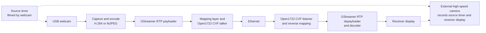

# Project RTS Video Streaming

## Goals

1. Capture video from a webcam and stream it over Ethernet using Open1722 CVF, supporting both H.264 and MJPEG.
2. Measure glass-to-glass latency and investigate which factors affect it.

Open1722 already supports CVF headers, but its example applications need extensions and integration to support this webcam streaming use case. Any required library changes will be identified during the code audit.

## Project Plan

1. Obtain suitable hardware and confirm supported webcam formats.
2. Inspect the relevant Open1722 examples, build and test the existing code, and identify required changes.
3. Test local capture and both codecs with GStreamer, then establish an RTP/UDP connection between the two computers as a baseline.
4. Implement the CVF streaming integration:
   - H.264 CVF implementation using GStreamer's RTP packetizer and depacketizer.
   - MJPEG CVF implementation using the shared integration.
   - Correct payload mapping, fragmentation, markers, timestamps, pacing, and presentation scheduling.
5. Validate the streams using Wireshark and independent depayloaders. Add relevant tests and receiver statistics, and verify a warning-free strict build.
6. Establish an external optical latency measurement setup. Film a source timer and the receiving display together, compare their displayed times, and document measurement uncertainty. Add synchronized software timing to investigate individual pipeline stages.
7. Compare H.264 and MJPEG at comparable visual quality and matching resolutions/frame rates. Compare CVF with the RTP/UDP baseline and investigate selected encoder, buffering, and timing settings. Start at 720p30, then test 1080p where hardware permits.
8. Analyse latency, jitter, loss, bandwidth, and CPU usage. Complete scripts, raw data, setup instructions, and the final report.

### Order and Dependencies

- Hardware availability is required before live camera and network testing.
- The Open1722 audit and GStreamer baseline can proceed in parallel.
- CVF implementation depends on the integration design and working GStreamer pipelines.
- MJPEG can reuse the transport and integration developed for H.264.
- Controlled experiments depend on validated streams and a repeatable measurement method.
- Validation and documentation continue throughout the project.

## System Overview



## Hardware List

1. Two Raspberry Pi 4 or 5 boards, with suitable power supplies and cooling. This is the proposed embedded setup; the project brief uses two Linux PCs as the reference. Validate performance at 720p30 before increasing resolution or frame rate.
2. Two microSD cards, preferably 32 GB or larger, one per Raspberry Pi.
3. A UVC USB webcam supporting raw video and MJPEG. Confirm the exact model's supported modes before selection. Native H.264 output is optional because encoding can be performed in software.
4. One Ethernet cable for a direct connection.
5. A receiver monitor and suitable micro-HDMI-to-HDMI cable, plus a source timer display. A separate device can provide the timer display.
6. A smartphone or camera capable of high-speed recording, preferably 120 or 240 fps, and a stable mount for optical latency measurements.
7. Keyboard and mouse as needed for setup.

## Planned Repository Structure

The following structure is proposed and may change during implementation.

```text
.
├── docs/                      # Project plan, hardware list, diagrams, and report
├── include/                   # Headers for project-specific integration code
├── scripts/                   # Setup, experiment, and analysis scripts
│   └── analyze_latency.py     # Analyse recorded latency data and generate plots
├── src/
│   ├── talker/                # Sender: Webcam → GStreamer → Open1722 → Ethernet
│   └── listener/              # Receiver: Ethernet → Open1722 → GStreamer → Display
├── tests/                     # Tests for project-specific integration code
├── CMakeLists.txt             # Build configuration, if CMake is selected
└── README.md                  # Project overview and setup instructions
```

Changes to Open1722's existing examples or library will be maintained in an Open1722 fork, following its existing directory structure and build system. This repository will contain project documentation, experiments, and any separate integration code.
